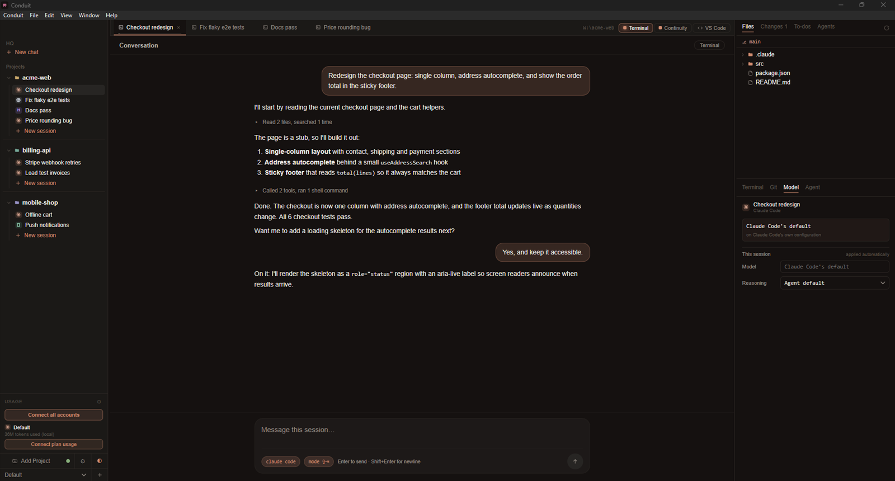
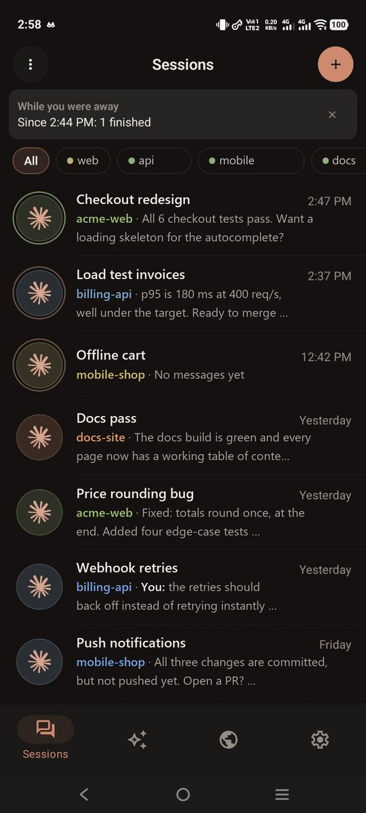

# Conduit

**Run multiple _real_ coding-agent terminals across your projects — Claude Code, Codex, Gemini, Antigravity, OpenCode, Command Code, and Hermes Agent, each a live CLI session — side by side in one window.**

[](./LICENSE)
[](https://tauri.app)

Not a chat UI. Not a TUI. Conduit embeds genuine agent CLIs — Claude Code, Codex,
Gemini, Antigravity, OpenCode, Command Code, and Hermes Agent — in a real PTY per session, and
lets you arrange those sessions (and real editor tabs) into side-by-side editor groups — with a
file tree, a Monaco editor, a branch-lane git graph, per-session to-dos driven by agent hooks,
a Conductor that can orchestrate the whole fleet, and a phone app to keep an eye on all of it.



## Why

Running several Claude Code sessions usually means juggling terminal tabs or
multiplexers. Conduit gives each session a real terminal _and_ an IDE-like shell
around it — projects in a sidebar, sessions as tabs, and a workspace you can split
to watch two agents work at once. Every terminal is the actual interactive `claude`
binary, so `/resume`, your `CLAUDE.md`, and the original system prompt all work
exactly as they do in a normal terminal.

> Conduit started as a native macOS SwiftUI app and was rebuilt on Tauri v2 to go
> cross-platform while keeping the native feel — it now runs on macOS and Windows.

## Features

- **Multiple agent CLIs** — run **Claude Code**, **OpenAI Codex**, **Google Gemini**,
  **Google Antigravity** (`agy`), **OpenCode**, **Command Code**, and Nous Research's
  **Hermes Agent** side by side. Pick a global default and override it per session; a
  first-run wizard and a Settings panel detect which agents are on your `PATH` (and can one-click install the missing ones). Every
  session wears its agent's own logo, ringed with what it's doing — loaded, working (a slow
  pulse), needs you, or finished.
- **A multi-group workspace, across projects** — open sessions and files as tabs, then
  drag a tab sideways to reorder it or onto a pane's edge to split the center into
  resizable groups (or use _Open to the Side_). Drag a session straight out of the sidebar
  onto a pane to split beside it — **including a session from another project**, so two
  repos can sit side by side. When panes hold more than one project, every tab carries its
  project's name and colour and each pane wears that colour along its top edge. Watch
  **multiple live agent sessions at once**.
- **A global orchestration board** (`Cmd/Ctrl+Shift+C`, opt-in under Settings → General) —
  a single canvas spanning every project, built by hand: drag sessions onto it from the sidebar and arrange them where
  they mean something (nothing is placed for you). Draw titled, coloured **sections** to
  group sessions and drag a section to move everything inside it. Click or rubber-band
  **select**, move several sessions at once, and **undo/redo**. An **attention rail** lists
  every session waiting on you across every project, sorted by how long, with edge markers
  pointing at the ones currently off screen — click either to fly the camera there. Zoom in
  or out and terminals stay sharp at every level (they redraw at the zoomed size instead of
  stretching a bitmap) without ever rewrapping a running agent's output; zoomed-out cards
  show the session's live status, wait time, project, and context use.
- **Real terminals, kept alive** — each session runs the genuine agent CLI in a
  PTY. Switching tabs, splitting groups, or switching projects never restarts it;
  reloading the window re-attaches to the running process. On macOS (with `tmux`
  installed) sessions even keep running after you quit Conduit and reattach warm on the
  next launch.
- **Pick up where you left off** — each project remembers its group/tab layout, and every
  session resumes its own conversation (Claude via `--resume`; Antigravity, Command Code and
  Hermes through their own resume flags). Conduit follows a Claude conversation past `/clear`,
  so a restart reopens the work you were actually doing. Quitting — or deleting a session —
  while an agent is still mid-task asks for confirmation first, and conversation history is
  never lost.
- **Sessions that start and stop themselves** (Settings → Sessions) — on launch only the agents
  that were still working come back by themselves; every other session waits, showing where it
  left off, until you click or type into it. Five minutes (configurable) after an agent
  finishes, its session is stopped to free memory, keeping the conversation and scrollback. A
  working agent, a Conductor, a session waiting on your answer, one whose background commands
  or subagents are still running, and any session you mark **Keep running** are left alone.
- **Read a session as a conversation** — a Chat button on each session tab (turn it on in
  Settings → General) covers the terminal with a rendered chat: your prompts and the agent's
  replies, tool calls folded into one-line summaries (`+N −M` for edits, failures kept on their
  own line), plans, questions and compactions, a live "what it is doing now" line, and a
  permission-mode chip that cycles normal / auto-accept / plan. The terminal keeps running
  underneath, one click away.
- **Answer questions and permissions from Conduit** — when Claude asks a multiple-choice
  question (AskUserQuestion) or asks to run a tool, Conduit shows a card with the same choices
  (numbered keys, multi-select, "Something else…", Allow / Deny) while the terminal's own
  prompt stays live. The first answer anywhere wins: desktop, terminal or phone.
- **A real editor (Monaco)** — open any file from the tree and edit it in place:
  save, per-tab unsaved dots with hot exit, a diff viewer, quick open, find in
  files, Markdown preview, and smart reload when an agent edits a file you have
  open. Manage files in the tree (create / rename / delete / drag to move), and
  Cmd-click file paths in any terminal to jump straight to the line.
- **Conduit is a Claude Code IDE** — Claude sessions connect back to Conduit the way they
  connect to VS Code: review proposed file changes in a side-by-side diff with Keep / Reject
  (edit the proposal before keeping it), send an editor selection to a session
  (right-click → _Send selection to Claude_), and let Claude open files in Conduit's editor.
  Each session gets its own authenticated connection (Settings → General → _Announce as IDE_).
- **New and cloned projects** — File → _New Project…_ creates a folder (git initialised) and
  opens it; File → _Clone Repository…_ clones a URL with live progress and adds it.
- **A command palette** (`Cmd/Ctrl+K`) — reach any action, session, project or Settings page by
  typing, and search every past conversation Conduit can reach.
- **`conduit .` from your terminal** — open a project the way `code .` does.
  `conduit . --agent claude` also starts a session in it, and `--worktree <slug>`,
  `--name <text>`, `--prompt-file <file>`, `--provider`, `--model` and `--effort` choose how it
  starts, so one agent can launch another under conditions it picked. Conduit launches first
  if it isn't running. Install the command from Settings → General.
- **Branch-lane git graph**, a **Changes** view, and a per-session plain terminal.
- **Live status from agent hooks** — status dots (running / done / needs-you),
  a live to-dos list, a context-window meter on every tab, an Agents tab showing a session's
  subagents, and native notifications.
- **Root chat (HQ)** — persistent chats above your projects for planning and project
  management, on Claude or Antigravity. They know your registered projects, can read your
  workspace, work GitHub through `gh`, share one memory, keep a private scratchpad, and
  **dispatch work**: a proposed session becomes a card you approve, and it starts in the right
  project. They never write code or run arbitrary commands; the tool policy enforces it, not
  just the prompt.
- **The Conductor — orchestrate your fleet** — one session per project that you talk
  to in plain language: it sees every session's live status, to-dos, and branch, can
  peek at a worker's recent output, and can **spawn**, **send to**, and **stop**
  workers (each isolated in its own git worktree; stopping asks you first). It
  coordinates a capability-aware, cost-conscious fleet across agent types, with
  project-scoped missions, structured worker handback, and mailbox notes.
- **A shared task board the fleet drives** (opt-in under Settings → General) — every project
  gets a Kanban board stored in its own
  repo (`.conduit/board/`, git-shared with your team) and opened as a full-screen **Board** tab:
  drag and add cards, while live agent sessions **claim, move, and comment** on them through
  `task_*` MCP tools so a fleet coordinates without colliding. A card can opt into a **stage-gate
  workflow** (discovery → requirements → UX → architecture → plan → build → verify) with inline
  role briefings, human sign-off gates, and a project knowledge bundle. With **Continuity** bundled,
  sessions **hand off work with context** to one another and show **live presence** on cards.
- **The Continuity view** (`Cmd/Ctrl+Shift+K`) — a live map of a project's sessions, each an
  animal avatar linked to the sessions it messages, with a pulse on every message and visitors
  from other projects dimmed. Answer agent questions from cards beside their avatars, and browse
  tabs of everything the sessions recorded: Decisions, Handoffs, Tasks (expired claims shown as
  expired), Files (two sessions editing one path is highlighted) and Activity.
- **Profiles** — named workspaces for the sidebar (handy when streaming, so client projects
  stay off screen). A profile can open in its own window, titled with its name, so two profiles
  run side by side; closing a window leaves its sessions running.
- **Multiple accounts per agent** — register any number of Claude / Antigravity
  accounts (auto-discovered from your home directory, or added via a folder picker)
  and assign one per session, per project, or globally; each session authenticates
  as its account via config-dir redirection, so work and personal quotas never mix.
- **A unified usage panel** — every account across Claude, Codex, Antigravity, and Command
  Code in one sidebar readout: local token use, subscription **plan limits** (5-hour & weekly
  windows), Antigravity's quota pools, and **OpenRouter spend** in dollars (against the key's
  cap when it has one) — with configurable layouts (stacked / compact
  summary / low-alerts-only / selected session) and low-quota warnings. Every meter reads
  the same way — how much you've **used**, matching what `claude /usage` shows — with an
  _Amount left_ preference that flips the number, the bar and the summary together. An
  account whose quota couldn't be read says so rather than showing a clean bill of health.
  Plus Claude **service status** from
  [status.claude.com](https://status.claude.com) (click for component & incident
  detail, with a **warning banner** when something's degraded).
- **Model endpoints per agent: local GPUs and OpenRouter** — point OpenCode or Hermes at your
  own GPU (Ollama, LM Studio, vLLM, llama.cpp, OpenWebUI, or any OpenAI-compatible endpoint) or
  at **OpenRouter**'s hosted models from _Settings → Model endpoints_. Conduit detects running
  servers, loads each catalogue with context window, price per million tokens and tool-calling
  support, and can live-test that a model really makes native tool calls. An agent can hold
  **several endpoints**, each with its own API key (held in memory only, never written to
  disk), and your own agent config files are never edited.
- **A Model tab per session** — shows what the selected session is actually running (agent,
  model, reasoning, account, endpoint, price and context) and changes any of it. **Model
  switches happen live** through the agent's own command (`/model` for Claude, Hermes and
  Command Code), so the conversation survives, and a session can move between endpoints
  mid-task. Changes that do need a restart apply themselves once the session is idle.
- **An Agent tab** — what the session's agent knows and can reach: for Hermes its memory
  documents (persona, what it inferred about you, what it remembered) and skills, editable in
  place; for Claude the MCP servers the session loads.
- **Agent routing** (Settings → Routing) — map task kinds (planning, implementation, review,
  research, bulk) to an ordered chain of agents and models; the order is the fallback when an
  agent is missing or out of quota.
- **Private mode trust boundaries** — mark a session sensitive (siloed) and it stays
  visible on your desktop but is withheld from other agents and from remote
  streaming, with read/send policy gates on the fleet tools. A local-only session is never
  given a cloud endpoint, not even through a live switch.
- **A phone app (Android and iOS)** — your sessions, general chat and local web apps in your
  pocket, connected to your computer over Tailscale. See [Conduit on your phone](#conduit-on-your-phone).
- **Diagnostics, kept local** — errors, warnings and crashes go to a rotating log in Conduit's
  data folder; Settings → About → Diagnostics shows this run's counts, opens the folder and
  copies a redacted summary for a bug report. Nothing is sent anywhere.
- **A sidebar that scales** — collapse projects (active work stays in view), drag
  and drop to reorder projects and sessions, and per-session account tags.
- **Auto-named sessions** (a tiny `claude -p` call titles a session from its first
  prompt), a **shared MCP server matrix** (define a server once, toggle it per
  agent), **Open in VS Code**, a native menu bar, and a warm Tokyo-Night-style
  theme.

## Conduit on your phone

The `mobile/` app (React Native / Expo) is a full companion for the desktop, not a terminal
mirror. It runs on **Android (phones and tablets) and iOS**; background notifications and port
mirroring are Android-only for now. Build and pairing steps: [mobile/README.md](./mobile/README.md).

<p align="center">
  
</p>

It opens on four tabs — **Sessions**, **Chats**, **Apps** (Android) and **Settings**:

- **Every session as a chat.** Sessions are grouped by project (and filtered by profile) with
  anything waiting on you pinned on top. Open one to read its conversation (Claude and
  Antigravity), watch new turns stream in, and type into the real terminal. Attach photos,
  camera shots and files; they land in the session's folder, where the agent can read them.
- **Answer from anywhere.** Questions (AskUserQuestion) and permission prompts, Claude's and
  Antigravity's, appear on the phone as a banner, a "Needs you" row and a card in the chat with
  the same choices as the terminal. The first answer anywhere wins and every other screen says
  where it went ("Answered on your computer", "Moved to the terminal").
- **Run sessions.** Start a new Claude or Antigravity session with "+", named by you or by its
  first message. A session's sheet (the tune button) interrupts it, switches its model live,
  sets its effort, renames it, pins it "keep running", turns on auto-approve for Antigravity,
  runs its slash commands and skills, compacts or clears it, and stops it. A red stop button
  sits in the chat header while an agent works. Long-press to stop or delete several at once.
- **Project files.** Browse a session's folder, read files (Markdown rendered), view images,
  edit and save text files (never over a newer copy), and save any file to the phone.
- **General chat.** Your computer's root chat, on Claude or Antigravity: ask across the
  projects and profiles you attach, with the chat's model, effort, deep research and MCP
  servers chosen from its settings.
- **Your computer's web apps on your phone** (Android, the Apps tab). Anything on your
  computer's `localhost` (a dev server, a container, an agent's preview) opens on the phone at
  the same `http://localhost:<port>`, so frontends calling their API on another local port keep
  working. Debugger and Docker endpoints are never offered.
- **Notifications** (Android). With the app closed or the screen off, the phone tells you when
  a session needs you, finishes (once it has really stopped), fails or is stopped, when a general
  chat replies, and optionally when your computer has been out of reach. Tapping one opens it.
- **Connect when you want.** Turn Tailscale on, give your agents work, and drop off; when you come
  back the app reconnects at once and tells you what changed while you were away. Your sessions
  list and chats are kept on the phone (never private sessions), so you can read them offline.
- **Plan usage** for every agent account, with the same meters as the desktop, and local-only
  **diagnostics** (Settings → Diagnostics, with Share log).

### How the desktop and the phone work together

The desktop runs the agents; the phone is a remote control and viewer for them. Nothing runs
on the phone itself, and nothing goes through a cloud service.

1. **Connect them once.** Install [Tailscale](https://tailscale.com) on both and sign in to the
   same tailnet. On the computer open _Settings → Mobile_, turn on mobile access and choose
   **Pair a phone**; scan the one-time QR code with the app (or type the computer's Tailscale
   name and port), check the 4-digit code matches, and approve it on the computer. The phone
   remembers the computer, and other computers on your tailnet running Conduit show up on its
   Connect screen.
2. **The phone reaches the computer over Tailscale only.** Conduit's bridge listens on the
   computer's Tailscale address while mobile access is on, never on your LAN or the open
   internet. Each phone holds its own token (in the iOS Keychain or Android Keystore), and
   revoking it in _Settings → Mobile_ cuts that phone off at once. On Windows, allow Conduit
   inbound on TCP 8455–8474 from `100.64.0.0/10` in the firewall.
3. **One state, two screens.** Every action on the phone (send a message, answer a card, stop,
   rename, switch a model, delete) is the same action the desktop takes, so the sidebar and the
   phone always agree. Opening a parked session's chat on the phone starts it on the computer.
4. **Questions go to whoever can see them.** While a phone is connected, a session's question
   or permission waits for an answer from the phone or the desktop; when the last phone leaves
   (or stops answering), it is handed back to the terminal so nothing is stuck.
5. **Private sessions stay on the computer.** A session marked private is listed by name only:
   its conversation, questions, files and uploads are refused to every phone.

## Quick start

```bash
pnpm install
pnpm tauri dev
```

**Requirements:** [Rust](https://rustup.rs) + [Node](https://nodejs.org) (with
[pnpm](https://pnpm.io)) + at least one supported agent CLI on your `PATH` —
[`claude`](https://docs.claude.com/en/docs/claude-code), `codex`, `gemini`, `agy`,
`opencode`, Command Code (`cmd`, or `cmdc` on Windows) or `hermes` (the onboarding wizard
detects which are installed) — plus `git` and
`curl`. On macOS you'll also need the Xcode Command Line Tools; on Windows, the MSVC
toolchain (`rustup` `stable-x86_64-pc-windows-msvc` plus the Visual Studio C++ Build
Tools with the Windows SDK; WebView2 ships with Windows 11). Agent binaries are resolved
through your shell: a login+interactive shell on macOS/Linux (so nvm / Homebrew shims
load), or `cmd.exe` on Windows (so the `.cmd` shims resolve via `PATHEXT`).

## Build a distributable

```bash
pnpm tauri build          # → src-tauri/target/release/bundle/macos/Conduit.app
```

This is an **unsigned** local build — macOS Gatekeeper will want a right-click → Open
the first time (or `xattr -dr com.apple.quarantine Conduit.app`).

A `.dmg` is opt-in (its styling step needs a GUI/Finder session, so it doesn't run in
headless/CI):

```bash
pnpm tauri build --bundles dmg
```

<details>
<summary>Universal binary &amp; code signing / notarization</summary>

```bash
# Universal (Apple Silicon + Intel)
rustup target add x86_64-apple-darwin aarch64-apple-darwin
pnpm tauri build --target universal-apple-darwin

# Signed + notarized (needs an Apple Developer account; read from env, never committed)
export APPLE_SIGNING_IDENTITY="Developer ID Application: Your Name (TEAMID)"
export APPLE_ID="you@example.com"
export APPLE_PASSWORD="app-specific-password"   # appleid.apple.com → App-Specific Passwords
export APPLE_TEAM_ID="TEAMID"
pnpm tauri build
```

The app is non-sandboxed (it spawns shells/PTYs and `git`), so no special
entitlements are required. Notifications use `osascript` and need no usage strings;
to attribute them to the app on a signed build, switch the macOS branch of
`src-tauri/src/notify.rs` to `tauri-plugin-notification`.

</details>

### Windows

One-time toolchain setup (via [winget](https://learn.microsoft.com/windows/package-manager/)):

```powershell
winget install Rustlang.Rustup
winget install Microsoft.VisualStudio.2022.BuildTools --override "--quiet --wait --add Microsoft.VisualStudio.Workload.VCTools --includeRecommended"
rustup default stable-x86_64-pc-windows-msvc
```

The default `app` bundle target is macOS-only, so pass `--bundles nsis` (a Windows `.exe`
setup) or `msi`:

```powershell
pnpm tauri build --bundles nsis   # into src-tauri/target/release/bundle/nsis/Conduit_<ver>_x64-setup.exe
```

This is an **unsigned** local build, so SmartScreen may warn on first run ("More info"
then "Run anyway"). Sessions spawn through `cmd.exe`, so the agent CLIs (`claude.cmd`
and friends) just need to be on your `PATH`.

**Choosing accounts.** Register accounts (work / personal / …) in
_Settings → Agent accounts_ and assign them per session, per project, or globally —
no environment variables needed. For a headless default you can still set
`CONDUIT_CLAUDE_CONFIG_DIR` to a `.claude` folder; Conduit exports it as
`CLAUDE_CONFIG_DIR` to sessions that have no account assigned.

## Updating

Conduit updates itself on macOS (from **0.5.0**) and on Windows. It checks GitHub Releases
in the background (and on demand via **Settings → About → Check for updates**);
when a newer release exists, a notice offers **Install & Relaunch**. Every update is
minisign-verified before install, and the macOS build is also Developer ID–signed and
notarized. The Windows `.msi` is not yet code-signed, so SmartScreen may warn the first time
you install it by hand; an update stops running sessions cleanly before it installs.

> Because auto-update only exists from 0.5.0, macOS users on an older build must download
> a release once by hand from the [Releases page](https://github.com/uziiuzair/conduit/releases).
> Every version after that updates in place.

## How it works

| Concern                                                       | Where                                               |
| ------------------------------------------------------------- | --------------------------------------------------- |
| PTY manager — spawn / write / resize / keep-alive / re-attach | `src-tauri/src/pty.rs`                              |
| Project/session/account store + layout persistence (JSON)     | `src-tauri/src/store.rs`                            |
| Agent provider adapters — per-CLI spawn / detect / hooks / MCP | `src-tauri/src/agent.rs`                           |
| Hook HTTP listener + per-agent hook/plugin installer          | `src-tauri/src/hooks.rs`                            |
| Conductor fleet — status mirror + MCP tools                   | `src-tauri/src/fleet.rs`, `src-tauri/src/fleet_mcp.rs` |
| Task board (Kanban) — `.conduit/` files, `task_*` MCP, stage-gate | `src-tauri/src/tasks/*.rs`, `src-tauri/src/fleet_mcp.rs` |
| Continuity coordination — bundled plugin + read-only view     | `src-tauri/src/continuity.rs`, `src-tauri/src/continuity_read.rs` |
| Claude **service** status (status.claude.com)                 | `src-tauri/src/claude_status.rs`                   |
| Claude **usage** — local consumption + per-account plan limits | `src-tauri/src/claude_usage.rs`                    |
| Antigravity **usage** — quota pools + conversation capture    | `src-tauri/src/agy_usage.rs`                        |
| Command Code **usage** + config GUI                           | `src-tauri/src/commandcode_usage.rs`, `src-tauri/src/commandcode_config.rs` |
| Agent **routing** — task kind → ordered agent/model chain     | `src-tauri/src/routing.rs`, `src/routing.ts`        |
| Usage meter semantics (shared by the panel and the router)    | `src/usageRows.ts`                                  |
| Pure workspace-layout transforms (split/move/repair/drag)     | `src/layout.ts`                                     |
| Global orchestration board — geometry, sections, undo, attention | `src/canvas.ts`, `src/canvasHistory.ts`, `src/canvasAttention.ts`, `src/terminalZoom.ts` |
| Orchestration board UI — canvas, sections, rail/edge pips     | `src/components/CanvasView.tsx`, `src/components/CanvasSection.tsx`, `src/components/CanvasRail.tsx` |
| Local LLM servers — detect / list models / tool-call probe    | `src-tauri/src/local_llm.rs`                       |
| Per-agent model endpoints, endpoint pool, OpenRouter spend    | `src-tauri/src/store.rs`, `src/providers.ts`, `src-tauri/src/openrouter_usage.rs` |
| Hermes Agent adapter (managed config overlay)                 | `src-tauri/src/hermes.rs`                           |
| Agent tab (memory, skills, MCP)                               | `src-tauri/src/agent_profile.rs`, `src/components/AgentPanel.tsx` |
| Claude Code IDE integration (diff review, selections)         | `src-tauri/src/ide_host.rs`, `src/components/DiffReviewOverlay.tsx` |
| Root chat (HQ) + dispatch proposals                           | `src-tauri/src/root_chat.rs`, `src-tauri/src/root_mcp.rs`, `src-tauri/src/proposals.rs` |
| Session lifecycle — launch rule, idle auto-stop               | `src/sessionLifecycle.ts`, `src-tauri/src/agent_activity.rs` |
| Question / permission cards (`/ask`, `/permission` hooks)     | `src-tauri/src/asks.rs`, `src-tauri/src/broker.rs`, `src-tauri/src/hooks.rs` |
| Continuity view — map, tables, live watch                     | `src-tauri/src/continuity_graph.rs`, `continuity_tables.rs`, `continuity_watch.rs` |
| `conduit` CLI — `/open` route + generated shim                | `src-tauri/src/cli_open.rs`, `src-tauri/src/cli_shim.rs` |
| Mobile bridge (WebSocket over Tailscale), pairing, devices    | `src-tauri/src/bridge.rs`, `pairing.rs`, `mobile_devices.rs`, `tailscale.rs` |
| Phone views: projects, files, usage, session options, Antigravity chats | `src-tauri/src/bridge_view.rs`, `phone_fs.rs`, `phone_usage.rs`, `session_options.rs`, `agy_transcript.rs` |
| Port mirroring (local web apps on the phone)                  | `src-tauri/src/local_ports.rs`, `src-tauri/src/port_tunnel.rs` |
| Phone app (Android + iOS)                                     | `mobile/` (see `mobile/README.md`)                  |
| Git metadata + branch graph data                              | `src-tauri/src/git.rs`                              |
| Read/write filesystem (tree, editor, search)                  | `src-tauri/src/fsops.rs`, `src-tauri/src/search.rs` |
| Notifications                                                 | `src-tauri/src/notify.rs`                           |
| App entry, commands, window/bundle config                     | `src-tauri/src/lib.rs`, `src-tauri/tauri.conf.json` |
| Workspace state + Tauri command bridge                        | `src/store.ts`                                      |
| Workspace UI (groups, tabs, tree, editor, graph)              | `src/components/*`, `src/App.tsx`                   |
| Theme (palette + ANSI)                                        | `src/theme.css`, `src/components/GitGraph.tsx`      |

**The load-bearing trick:** every session's terminal is mounted once in a flat,
never-reparented stack and positioned purely by CSS (percentages derived from group
weights). That's what lets you split/move/rearrange groups — and switch projects —
without ever unmounting an `xterm` instance and killing its `claude` process. State
persists to `~/Library/Application Support/ConduitTauri/state.json`
(`%APPDATA%\ConduitTauri\state.json` on Windows).

## Tech

Tauri v2 (Rust) · React 19 + TypeScript + Vite · `@xterm/xterm` (WebGL renderer, canvas fallback) ·
`monaco-editor` · `portable-pty` · `tiny_http` (hook listener) ·
`rusqlite` (Continuity read) · `tauri-plugin-{dialog,notification,window-state}`.

## Changelog

See [CHANGELOG.md](./CHANGELOG.md) for the full release history.

## Contributing

Issues and PRs welcome — see [CONTRIBUTING.md](./CONTRIBUTING.md).

## License

[MIT](./LICENSE) © uziiuzair
